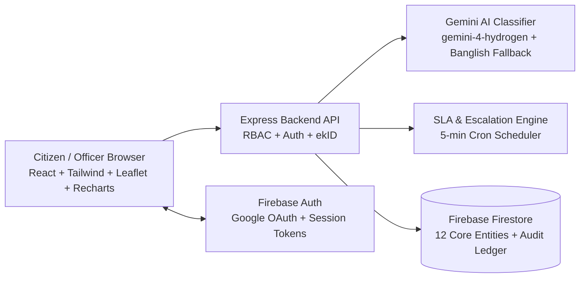
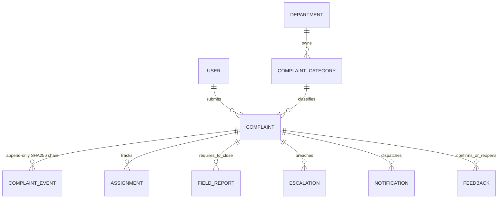

# JanataVoice BD — One-Stop AI Complaint System

A unified civic grievance, AI classification, SLA enforcement, and cryptographic audit platform for Bangladesh government services.

## Architecture Overview

## Core Data Model (ERD)

## Seeded Demo Credentials

All seeded demo accounts use password: **`Demo@2026`**

| Role | Email | Department | Jurisdiction |
| :--- | :--- | :--- | :--- |
| `citizen` | `citizen@janatavoice.gov.bd` | — | Dhaka |
| `triage_officer` | `triage@janatavoice.gov.bd` | All | Dhaka |
| `field_worker` | `worker.lgd@janatavoice.gov.bd` | LGD | Dhaka |
| `dept_officer` | `officer.lgd@janatavoice.gov.bd` | LGD | Dhaka |
| `dept_head` | `head.lgd@janatavoice.gov.bd` | LGD | Dhaka |
| `high_authority` | `cabinet@janatavoice.gov.bd` | Cabinet | National |
| `admin` | `admin@janatavoice.gov.bd` | System | National |

## What Is Mocked vs. Real

| Capability | Implementation |
| :--- | :--- |
| **Database & Persistence** | Real Firebase Firestore (`firebase-blueprint.json` + `firestore.rules`) with automatic server-side seeding (6 departments, 20 categories, 40 users, 150 complaints). |
| **Authentication** | Real Google Sign-In via Firebase Auth + HMAC-signed credential sessions for all 7 roles. |
| **ekID (10-digit NID)** | Simulated government NID validation (`10 digits`) issuing signed `EKID-BD-2026-...` tokens and enabling once-only auto-fill across departments. |
| **AI Classification** | Real server-side `@google/genai` (`gemini-4-hydrogen`) structured JSON classification + deterministic Bangla/English/Banglish keyword fallback. |
| **SMS & Email Outbox** | Mocked outbox persisted in Firestore `notifications` (`SMS_MOCK`, `EMAIL_MOCK`, `IN_APP`) viewable by admins. |
| **Audit Integrity** | Real SHA-256 hash chain (`hash = SHA256(prevHash + payloadJson + timestamp)`) on append-only `complaint_events` simulating blockchain immutability without operational cost. |

## Build Stages

- **Stage 1**: Unified Auth + Mock ekID + Core Data Schema + 6 Departments / 20 Categories / 40 Users / 150 Complaints Seed
- **Stage 2**: Complaint Submission + Gemini AI & Banglish Keyword Fallback + Human Triage Queue + Ground-Truth Correction Logging
- **Stage 3**: Automated 5-Minute SLA & 4-Level Escalation Engine + Admin SLA Config Panel
- **Stage 4**: Department Officer Dashboard + Field Worker Geolocation & Before/After FieldReport Close Gate + Citizen Confirm/Reopen
- **Stage 5**: High Authority Cabinet Scorecards + Leaflet District Heatmap + Recharts Analytics + SHA-256 Audit Chain Verifier
